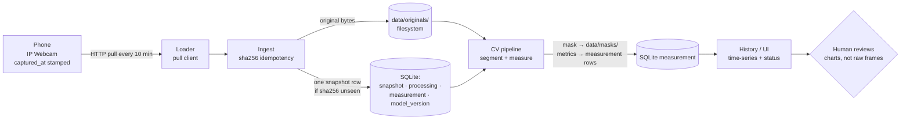

# PlantVision — Architecture

How the system is put together at Stage 0 — the five components, how data flows between
them, and what each one is NOT yet responsible for.

## Components

| # | Component | Responsibility (now) | Not responsible for (yet) |
|---|-----------|----------------------|---------------------------|
| 1 | **Phone (IP Webcam)** | Runs the IP Webcam app on the fixed mount; serves the latest frame at `http://<phone-ip>:8080/photo.jpg`; stamps `captured_at` via its own clock. | Push logic, motion detection, on-phone storage. |
| 2 | **Loader (pull client)** | At the configured interval, pulls a JPEG from the phone over HTTP and hands it to Ingest. | Scheduling decisions beyond the interval; image interpretation. |
| 3 | **Ingest (sha256 gatekeeper)** | Validates bytes, computes the sha256 idempotency key, skips re-sends, writes the original to `data/originals/`, inserts the `snapshot` row. | Image analysis; retention/backup decisions. |
| 4 | **CV pipeline** | Segments the plant, computes metrics (`projected_area_px`, `roi_fraction_pct`, bbox), records `processing` state and `measurement` rows. | deciding whether growth "looks good" — it only produces observations. |
| 5 | **History / UI** | Serves time-series views of measurements plus collector status; plots growth over selectable periods. | Write paths; metric computation; data mutation of any kind. |

## Data flow

## Where the observation discipline lives

The pipeline produces **observations** (masks, areas, time-series). These are not yet
*hypotheses* about plant health, and decisively not *confirmed events*. Idempotent raw
storage is what keeps the boundary honest: the raw originals stay immutable on disk, the
database stores metadata and measurements, and every downstream aggregation is a view over
those two — it can be re-derived, corrected, or discarded without touching the evidence.

## Boundary decisions recorded elsewhere

- Pull-not-push + 10-minute cadence + filesystem + SQLite: **ADR 0001**
  ([docs/decisions/0001-data-flow.md](decisions/0001-data-flow.md)).
- Per-frame field rules, idempotency definition, timestamp semantics:
  [docs/data-contract.md](data-contract.md).
- Capture gating (light window 06:00–22:00, `dark_policy: skip`): `configs/capture.yaml`.
- Retention and disk layout: [data/README.md](../data/README.md).
